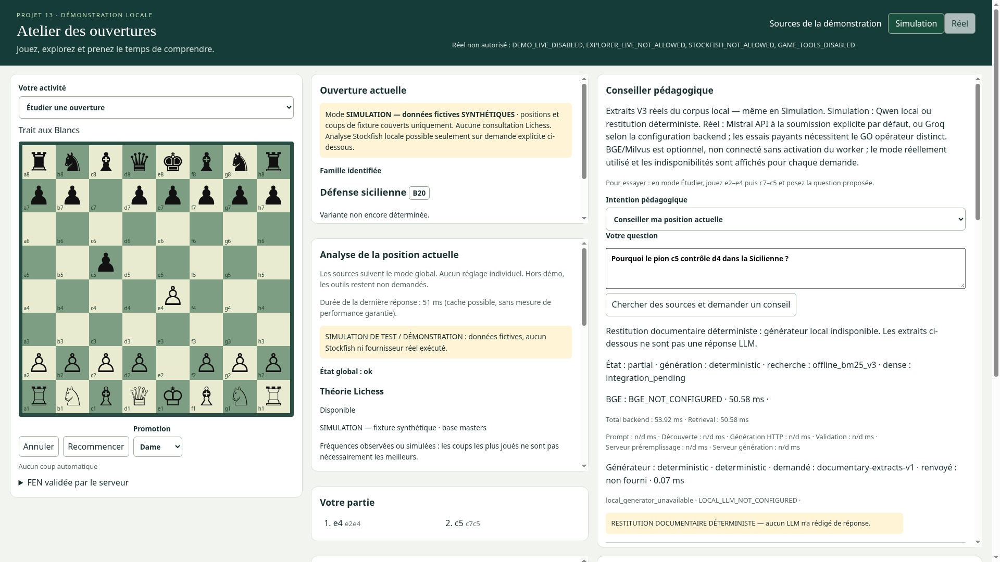
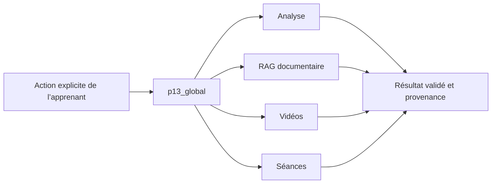

# Atelier des ouvertures — Agent IA pédagogique

**Projet 13 OpenClassrooms · Michel Levy · octobre 2026.** Un POC local pour le scénario de la Fédération Française des Échecs : apprendre à comprendre une ouverture en jouant, en analysant une position et en consultant des ressources sourcées.

> **POC local, code sous GPL-3.0-or-later.** L’installation Docker complète sur une machine vierge reste à éprouver. Les tests avec doubles et le scénario navigateur limité ne constituent pas cette recette. Voir [validation](docs/VALIDATION.md) et [limites](docs/LIMITES.md).



*Capture authentique de l’application exécutée dans Chromium avec son backend local : jeu et analyse en Simulation déclarée, corpus/BM25 authentiques et restitution documentaire déterministe. Aucune réponse LLM ou consultation fournisseur réel n’est présentée. Aucun média privé n’est inclus.*

## Fonctionnalités

- **Étudier une ouverture** : jouer les deux couleurs, annuler, suivre les coups et reconnaître ouverture/code ECO/variante depuis un catalogue local versionné.
- **Jouer contre l’ordinateur** : adversaire synthétique légal en Simulation ; politique explicite théorie Lichess puis Stockfish en Réel si autorisés. Atelier borné aux ouvertures.
- **Analyser** : statistiques Lichess Masters et évaluation Stockfish, provenance, bornes, erreurs et résultats partiels. Fréquence ne signifie pas meilleur coup.
- **Comprendre** : passages français attribués ; BM25 et admission de contexte, BGE-M3/Milvus optionnel ; réponse locale Qwen ou API Mistral/Groq sur demande explicite et sous configuration privée.
- **Explorer les vidéos** : trois intentions, au plus une vidéo distincte par intention ; YouTube disabled/fixture/live, aucun appel au chargement.
- **Conserver une séance** : MongoDB optionnel, sauvegarde explicite, consultation/reprise/suppression, sans relancer les fournisseurs à la reprise.

Revue pédagogique humaine du corpus et des réponses **toujours en attente**. Le POC ne remplace pas un entraîneur et n’est pas préparé à l’exposition publique multi-utilisateur.

## LangGraph : un parent, quatre branches



[Source éditable du résumé](docs/diagrammes/PARCOURS.mmd), [graphe compilé exact et quatre enfants](docs/diagrammes/GLOBAL_EXPANDED.mmd), [architecture détaillée](docs/ARCHITECTURE.md). Le serveur fixe l’intention selon la route, pas un LLM. Chaque enfant admet la demande, exécute une action métier puis contrôle son résultat. Les en-têtes `X-Workflow-Graph: p13_global_v1` et `X-Workflow-Path` tracent ce parcours, sans prouver à eux seuls qu’un fournisseur réel a été appelé.

## Technologies et ressources

Angular20.3/Vite, FastAPI/python-chess, LangGraph1.2, Stockfish15.1 UCI, Milvus2.5.26, BGE-M3dense1024D, MongoDB7.0 optionnel, llama.cpp/Qwen optionnel, APIs Lichess/YouTube/Mistral/Groq. [Dépendances et licences](docs/LICENCES.md), [inventaire des fichiers](docs/INVENTAIRE_RELEASE.md).

Linux ou Ubuntu WSL2 avec Docker et Compose≥2.24.4, Git. Ports applicatifs locaux5173/8001 ; **ne pas lancer en parallèle d’une autre application utilisant ces ports ou le sous-réseau172.30.73.0/29**. Le contrôleur refuse les ports occupés sans arrêter le processus existant.

Le mode limité ne charge pas de modèle. Pour BGE/Milvus, prévoir une machine d’au moins16 Gio de RAM avec marge réelle, environ12 Gio de disque libre avant acquisition des poids, et les images/dépendances en plus. BGE est borné à1 CPU/8 Gio, Milvus2 CPU/4 Gio, Mongo512 Mio ; ces plafonds ne sont pas un benchmark de mémoire consommée. Qwen optionnel ajoute2 CPU/4 Gio. [Installation détaillée](docs/INSTALLATION.md).

## Installation minimale sans clé

Depuis une machine de test dédiée disposant des prérequis :

```sh
git clone https://github.com/MshLvy/OC_PRJ13_Mettez-en-place-un-Agent-IA.git
cd OC_PRJ13_Mettez-en-place-un-Agent-IA
./scripts/p13 setup
./scripts/p13 start
./scripts/p13 doctor
./scripts/p13 smoke
```

`setup` crée un nouveau `.env` privé sans clé et refuse d’écraser un fichier existant. `start` construit les deux images applicatives et démarre frontend/backend seulement. Les téléchargements de dépendances publiques au build nécessitent réseau et disque ; aucun checkpoint n’est téléchargé. Ouvrir **http://127.0.0.1:5173**.

Simulation est le mode par défaut : coups/statistiques/score simulés sont identifiés. Le corpus documentaire et BM25 sont authentiques locaux ; si Qwen n’est pas disponible, l’interface montre une restitution documentaire déterministe, pas une génération fictive. Vidéos et Mongo sont désactivés. Une clé n’est pas nécessaire au jeu, à la classification locale ou aux passages BM25.

`./scripts/p13 stop` arrête seulement frontend/backend, sans supprimer volume ni service de base. [Commandes et effets](docs/OPERATIONS.md).

## Activer les services optionnels

Chaque activation est explicite ; aucune image, collection, réseau, base ou volume d’une autre installation n’est réutilisé implicitement.

- [Milvus neuf et acquisition/indexation BGE vérifiée](docs/BGE_MILVUS.md).
- [Mongo neuf, authentification et séances](docs/MONGODB.md).
- [Qwen local, Mistral/Groq et budgets](docs/FOURNISSEURS.md).
- [YouTube réel et quotas](docs/FOURNISSEURS.md).

Le projet Compose est **p13-release**, volumes `p13-release_milvus-data` et `p13-release_sessions-data`, collection `p13_openings_bge_1024_v1` dans **sa nouvelle instance Milvus**. Aucun port Milvus/BGE/Mongo/Qwen n’est publié. Aucune image privée n’est requise : les images RELEASE ont leurs propres Dockerfiles. Les checkpoints/volumes ne sont jamais des fichiers Git.

Le mode Réel requiert les plafonds serveur et les sources correspondantes. Il n’effectue aucun repli silencieux sur fixture. **YouTube suit YOUTUBE_MODE indépendamment du sélecteur Simulation/Réel**, sur clic explicite seulement. Ne pas activer Réel avant d’accepter les appels Lichess/Stockfish possibles à chaque position validée ; génération API et vidéos demandent leur propre budget.

## Démonstration : comprendre la Sicilienne

1. Choisir **Étudier une ouverture** ; sélectionner Simulation pour un parcours sans fournisseur externe.
2. Cliquer e2/e4 puis c7/c5. L’ouverture actuelle est reconnue localement ; aucune liste ne force le nom du plateau.
3. Poser « Pourquoi le pion c5 contrôle d4 dans la Sicilienne ? » avec **Conseiller ma position actuelle** puis **Chercher des sources et demander un conseil**.
4. Lire sources, scope et provenance de recherche/génération, y compris l’abstention ou l’indisponibilité.
5. Si les services ont été autorisés/configurés, choisir Sicilienne dans les panneaux Vidéos/Séances, explorer les vidéos puis sauvegarder une **nouvelle** séance et la reprendre.

[Recette complète avec FEN/UCI et plans de repli](docs/DEMONSTRATION.md). Pour démontrer Réel, configurer les fournisseurs **avant** la partie : la bascule réinitialise le plateau. Ne préécrire ni score, statistique ni réponse API.

## Vérifier et maintenir

```sh
# Depuis un environnement Python3.12 disposant des dépendances backend épinglées :
python scripts/test-backend.py
# Depuis frontend/ avec npm ci réalisé dans cette installation :
cd frontend
npm test
npm run build
```

Résultats effectivement obtenus sur les sources de cette distribution : **916 tests backend**, **169 tests frontend**, build Angular, six configurations Compose et un scénario Chromium limité. La [validation](docs/VALIDATION.md) précise leur portée : dépendances déjà installées utilisées, aucun test Docker vierge ni fournisseur réel. Les jeux de benchmark ne sont pas distribués. [Sécurité et audits](docs/AUDIT_RELEASE.md), [contrats API](docs/API.md).

## Droits, limites et perspective MCP

Corpus français sous **CC-BY-SA4.0** avec attributions/révisions ; catalogue factuel Lichess **CC0**. Modèles/images acquis séparément sous leurs propres conditions. **Code original sous [GPL-3.0-or-later](LICENSE.md)**. python-chess relève de GPL-3.0-or-later et Stockfish de GPL3 ; les notices et obligations correspondantes restent applicables. [Droits et notices](docs/LICENCES.md).

[Étude MCP d’analyse vidéo](docs/mcp/ETUDE.md) : dix sections, bénéfices/limites, architecture, hypothèses de coûts et Go/No-Go. Conception uniquement, aucun téléchargement ou analyse de vidéo livré. Une disposition des pièces ne fournit pas tous les six champs FEN ; droits de roque/prise en passant/trait inconnus ne sont jamais inventés.

**État : POC local documenté et testé avec doubles ; installation Docker vierge non démontrée.** Aucun jeu scellé, clé, poids, volume, donnée personnelle ou rapport interne n’est inclus.
